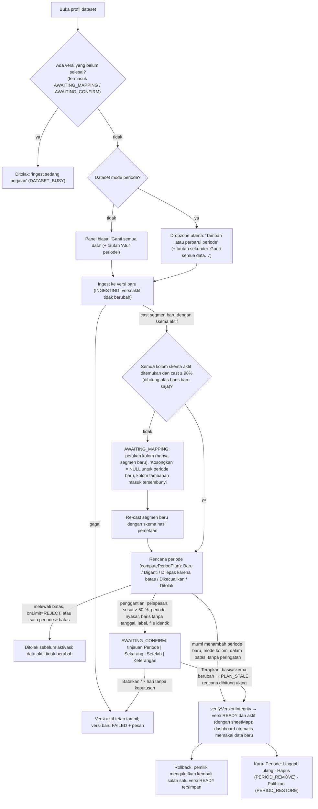

# ADR-0008: Model data periode: segmen typed per periode + manifest versi, dibaca sebagai daftar parquet dengan proyeksi eksplisit

> Status **accepted** 2026-10-18 (diusulkan 2026-10-17). Pemilik produk menyetujui kriteria pengganti di bawah
> (p95 ≤ 1,1× untuk query ≥ 100 ms, selain itu selisih ≤ 15 ms; halaman OFFSET tanpa urut dikecualikan) karena AC 1
> T-034 tidak lolos secara harfiah di M4. Ulang ukur di olympus (VM produksi, HDD, container worker produksi,
> `scripts/perf-segments.ts --reps 30`): 13/13 query yang dinilai lolos, 14/14 hasil identik, jendela 200 baris p95
> 22,3 ms, `union_by_name` tetap gagal (`docs/ai/perf/T-034.md` § Ulang ukur di olympus). Amandemen flow-kerja di
> akhir dokumen ini sudah diterapkan ke `docs/flow-kerja.md`.

## Context and Problem Statement

Pengguna mengunggah file dengan kolom sama tetapi periode berbeda (biasanya bulanan) dan ingin satu dataset/sheet
yang terus bertambah, dengan unggah ulang satu bulan mengganti bulan itu (bukan menggandakan), serta batas yang
tidak pernah memotong periode (rencana `docs/ai/plans/2026-10-15-tampilan-excel-dan-data-periode.md` §1.2, §4, §5).
Hari ini satu versi = satu `raw.parquet` + satu `typed-<rev>.parquet` per sheet (D3, D4 self-contained, hanya
REPLACE), setiap pembangun SQL membaca satu `read_parquet($path)`, `ParquetCache` menyewa satu kunci, dan retensi
menghapus per prefix versi. T-015 (append buta) sudah dibatalkan sebagai digantikan.

Pertanyaan: bagaimana periode disimpan sehingga (1) biaya unggah sebanding dengan periode baru, bukan total data,
terutama di olympus yang I/O-nya HDD bersama (T-024: ingest xlsx 1 GB 37 mnt, unduh 600 MB parquet ke cache 109 s);
(2) query dashboard, slicer, tabel, dan "Lihat data" tetap cepat dan hasilnya identik; (3) rollback, hapus, dan
pulihkan periode aman; (4) sandbox DuckDB aplikasi (enable_external_access=false + allowed_directories +
lock_configuration) tetap berlaku.

Bukti: spike T-034 (`docs/ai/perf/T-034.md`, skrip `scripts/perf-segments.ts`) mengukur lewat `QueryEngine`
aplikasi (memory_limit 1 GB, 2 thread, sandbox, satu koneksi per query) dan pembangun SQL aplikasi (`sql.ts`,
`table.ts`) pada 24 segmen × 400 rb baris vs satu file 9,6 jt baris (bentuk fixture csv T-024: 10 kolom).

## Considered Options

* **A. Hanya "Ganti semua"** — pengguna menggabung semua periode sendiri di Excel lalu mengganti seluruh data.
* **B. Dataset atau sheet baru per periode.**
* **C. Append buta T-015** — raw versi baru = raw aktif ∪ raw file baru, typing ulang seluruh union.
* **D. Segmen typed per periode + manifest versi** — setiap periode ditulis sekali sebagai segmen imutabel
  (`raw.parquet` + `typed-<rev>.parquet` di `parquet/<datasetId>/seg/<segmentId>/`); versi = daftar segmen per sheet
  (`SheetSegment`); query membaca `read_parquet([kunci segmen…])`; GC mark-and-sweep berbasis referensi.
* **E. Union self-contained berbatas dengan upsert per periode** — commit menulis ulang typed aktif (minus periode
  yang diganti/dilepas) + typed baru menjadi satu file per sheet per versi; tanpa cast ulang baris lama.
* **F. DuckLake** — katalog DuckLake (snapshot = daftar file) di samping Prisma.

### Biaya ops per unggahan

Skenario rencana §4.2: xlsx 1 GB/bulan (3 sheet × 1 jt × 30 kolom, ± 1,2 GB parquet raw+typed per bulan, ± 0,6 GB
typed), angka untuk **unggahan bulan ke-10**. Angka parse/typing dari baseline T-006/T-007 (SSD) dan T-024
(olympus); kolom I/O adalah perkiraan, bukan ukuran (lihat "Belum diverifikasi" di T-034).

| Biaya per unggahan (bulan ke-10) | A. Ganti semua | B. Sheet/dataset per periode | C. Append buta | **D. Segmen + manifest** | E. Union berbatas | F. DuckLake |
|---|---|---|---|---|---|---|
| Bisa dijalankan? | **Tidak**: 10 bulan = 10 jt baris/sheet > 1.048.576 baris xlsx dan > `MAX_UPLOAD_BYTES` 1 GiB | Ya, tapi dashboard antarbulan mustahil (1 `datasetId`, 1 `sheetId` per widget, tanpa union lintas sheet) | Ya, tapi unggah ulang menggandakan baris | Ya | Ya | Ya, dengan extension dipasang offline |
| Parse + typing worker | – | parse ± 5 mnt + typing ± 75 s | parse ± 5 mnt + typing 30 jt baris ± 12,5 mnt | parse ± 5 mnt + typing ± 75 s (sama tiap bulan) | parse ± 5 mnt + typing ± 75 s | parse ± 5 mnt + typing ± 75 s |
| Worker mengunduh dari storage | – | 0 | ± 6 GB raw aktif | **0** (hanya file baru) | ± 5,4 GB typed aktif (+ raw bila raw juga di-union) | 0 |
| Objek baru di storage (= pertumbuhan backup) | – | ± 1,2 GB | ± 12 GB | **± 1,2 GB** | ± 6–12 GB | ± 1,2 GB + katalog |
| Penyimpanan ditahan (3 READY + aktif) | – | ± 12 GB | ± 48 GB | **± 12 GB** + periode lama yang masih dirujuk versi tersimpan | ± 24–48 GB | ± 12 GB + snapshot DuckLake |
| Unduh ulang ke cache lokal app (10 GiB) | – | ± 0,6 GB | ± 6 GB (± 18 mnt di HDD olympus*) | **± 0,6 GB** (± 2 mnt*) | ± 6 GB (± 18 mnt*) | ± 0,6 GB |
| Deadline ingest 60 mnt / recast 20 mnt | – | aman | akhirnya terlewati | **aman** (recast per segmen, T-040) | I/O O(total) → akhirnya terlewati di HDD | aman |
| Muat dalam kuota 20 GiB (1 GB/bulan) | – | ± 10 bulan | ± 3 bulan | **± 10 bulan** (batas 10 jt baris/sheet yang lebih dulu kena) | ± 3 bulan | ± 10 bulan |
| Query | 1 file | 1 file per sheet periode (tanpa lintas periode) | 1 file | daftar ≤ 60 file; T-034: lihat Decision Outcome | 1 file | daftar file lewat extension |
| Komponen/risiko baru | – | – | – | tabel `Segment`/`SheetSegment`/`SheetLineage`, GC mark-and-sweep, refactor 16 modul `typedKey` | union + aturan `PERIOD_SOURCE_MISMATCH` | sumber kebenaran kedua di samping Prisma, format 0.x, extension offline |

\* Laju T-024 di olympus: ± 600 MB parquet per 109 s saat cache dingin (HDD bersama).

## Decision Outcome

Chosen option: "**D. Segmen typed per periode + manifest versi**", because satu-satunya opsi yang memenuhi semua
syarat fungsional (A tidak bisa dijalankan, B mematahkan dashboard antarbulan, C menggandakan baris) dengan biaya
unggah O(periode baru) — penting di olympus yang terikat I/O HDD — dan spike T-034 menunjukkan biaya bacanya
dapat diterima, **walaupun AC 1 T-034 ("p95 ≤ 1,1× file tunggal") tidak lolos secara harfiah**:

* Hasil identik di 14/14 query aplikasi (dua run, 30 dan 40 putaran) dan 22/22 query campuran legacy + baru
  (proyeksi eksplisit).
* Query ≥ 100 ms (group-by teks/bulan, tabel terurut, filter-values teks) p95 0,92–1,10× file tunggal; 24 segmen
  223,1 MB vs file tunggal 223,5 MB.
* Gagal > 1,1× secara konsisten: count tanpa filter (2 → 5–6 ms p50, +4–6 ms p95), filter-values tanggal (+7–13 ms
  p95), dan halaman terakhir tabel tanpa urut (OFFSET 9.599.900: 1,45–1,49×, +90–100 ms) — yang terakhir adalah sort
  penuh `_row` dan dimitigasi jalur jendela (butir 6 di bawah). Tiga query lain melewati 1,1× di salah satu run saja
  (+4–7 ms, derau mesin terbebani). Overhead tetap ± 0,11–0,14 ms per file (count: 1,6 / 4,8 / 8,3 ms pada
  1 / 24 / 60 file).
* Jendela 200 baris lewat (segmen, `file_row_number`): p95 14,6–16,3 ms (target ≤ 50 ms), 0 baris salah, termasuk
  jendela yang melintasi batas segmen.
* Fallback E memindahkan biaya ke **setiap unggahan**: pada bulan ke-10 ± 5–6 GB dibaca, 6–12 GB ditulis, dan ± 6 GB
  diunduh ulang ke cache app (± 18 menit di HDD olympus hanya untuk cache). Ditukar dengan ≤ 13 ms per query kecil,
  itu tidak sepadan. Karena itu kriteria gagal rencana §4.12 ("p95 > 1,1×") **diperhalus** menjadi kriteria fallback
  di bawah (relatif untuk query ≥ 100 ms, absolut untuk query kecil). Ini keputusan pemilik saat menerima ADR ini.

Rincian yang diputuskan bersama:

* **Satuan penyimpanan** = segmen per (sheet logis, periode): `raw.parquet` + `typed-<rev>.parquet` imutabel di
  `parquet/<datasetId>/seg/<segmentId>/`. Versi = manifest `SheetSegment(sheetId, segmentTypedId, ordinal)`. Sheet
  lama dimigrasikan menjadi satu segmen legacy per sheet (`rowBase` 0) yang tetap merujuk kunci lamanya (T-036).
* **Isi typed segmen**: `_row BIGINT = rowBase + baris fisik` (unik per sheet logis, dari
  `SheetLineage.rowHighWater` secara atomik), `_src_row`, `_period DATE` (hanya versi periode), `c<pos>` kanonik.
  Ditulis seperti sekarang (zstd, 1 thread, row group 122.880 untuk ± 30 kolom). Spike: 24 segmen 223,1 MB vs file
  tunggal 223,5 MB — tidak ada overhead ukuran.
* **Cara membaca daftar segmen (wajib)**:
  1. Daftar path dikirim sebagai **satu parameter** `read_parquet($path)` berisi `listValue([...])` dari
     `@duckdb/node-api` — bukan larik JS biasa (ditolak: "Cannot create values of type ANY"), bukan literal SQL.
     Daftar kosong ditolak node-api ("item type of ANY") → pemanggil wajib menolak manifest kosong lebih dulu.
     Tipe `params` di `QueryEngine.exec`/`BuiltSql` dilebarkan ke `DuckDBValue` (T-037).
  2. Bila **semua** segmen sheet punya set kolom dan tipe `_row` yang sama: satu `read_parquet($path)` atas daftar.
  3. Bila berbeda (segmen legacy `_row INTEGER`, kolom tambahan setelah segmen lama ditulis): **proyeksi eksplisit
     per kelompok skema** — `SELECT CAST(_row AS BIGINT) AS _row, …, CAST(NULL AS <tipe skema>) AS c<pos> FROM
     read_parquet($g0) UNION ALL …`, kelompok diturunkan dari metadata `Segment.columns` + tipe `_row`.
  4. **Daftar polos tanpa penyesuaian dilarang** untuk skema campuran: DuckDB memakai skema file pertama, sehingga
     hasilnya bergantung urutan (kolom tambahan "not found", "schema mismatch in glob", atau `_row` BIGINT > 2^31
     gagal di-cast ke INTEGER) — dan query halaman tabel gagal karena bug di butir 5.
  5. **`union_by_name` dilarang** di DuckDB 1.5.6: bila tipe satu kolom berbeda antarfile (legacy `_row INTEGER` vs
     baru `_row BIGINT`), query halaman tabel (late materialization `_row IN (SELECT … ids)`, yang memicu filter
     bloom dari hash join) gagal "Not implemented Error: Can't convert TableFilterType (BLOOM_FILTER) from global
     to local indexes" — baik dengan `union_by_name` maupun daftar polos. Perbedaan set kolom saja (tanpa beda tipe)
     tidak memicunya. Proyeksi eksplisit menghindarinya karena setiap `read_parquet` hanya berisi file berskema
     sama. Boleh dievaluasi ulang hanya lewat task upgrade DuckDB yang menjalankan ulang `scripts/perf-segments.ts`.
  6. **Halaman tabel tanpa urut dan tanpa saring** (widget tabel T-011 dan "Lihat data") memakai jalur jendela
     (segmen, `file_row_number`) di bawah, bukan `ORDER BY _row LIMIT/OFFSET`: OFFSET dalam = sort penuh `_row`
     (9,6 jt baris), yang pada daftar 24 file 1,3–1,45× lebih lambat daripada file tunggal (T-034).
* **Jendela tanpa urut ("Lihat data", D16)**: posisi global → (segmen, `file_row_number`) dari jumlah kumulatif
  baris segmen (metadata DB, urut periode lalu ordinal); hanya segmen yang beririsan yang disewa dan dibaca,
  `read_parquet($sK, file_row_number = true) WHERE file_row_number BETWEEN $aK AND $bK`, `UNION ALL`, urut
  `(k, file_row_number)`. Urutan tidak bergantung pada `_row` (periode yang diganti mendapat `_row` lebih besar).
* **Sandbox tetap**: daftar path hanya berisi kunci dari manifest di bawah direktori cache lokal; spike membuktikan
  daftar yang memuat satu path di luar `allowed_directories` ditolak utuh (Permission Error), `..` yang keluar
  direktori juga ditolak.
* **Cache dan sewa**: `ParquetCache` menyewa semua kunci segmen satu sheet dalam satu admission (batch lease);
  setelah aktivasi hanya segmen baru yang di-prefetch (T-037). Kunci cache hasil tetap memuat `versionId`.
* **GC**: mark-and-sweep berbasis referensi versi hidup (aktif, READY tersimpan, non-terminal) dengan tenggang
  `SEGMENT_GC_GRACE_HOURS` 24 jam, job malam HEAD semua kunci terujuk, `verifyVersionIntegrity` fail-closed sebelum
  setiap aktivasi (T-038).
* **Batas daftar file**: `PERIOD_KEEP_MAX` 60, `PERIOD_SHEET_MAX_SEGMENTS` 120 (rencana §5.2).

### Kriteria fallback

Pindah ke **opsi E (union self-contained berbatas, rencana §4.12)** — UX, `computePeriodPlan`,
`verifyVersionIntegrity`, layar tinjauan, dan task T-049 dst. tetap; yang diganti T-036–T-038 dan T-040 — bila salah
satu terjadi dan tidak bisa ditutup dalam 2 hari kerja:

* p95 `read_parquet` atas daftar segmen > 1,1× file tunggal pada query yang p95 file tunggalnya ≥ 100 ms
  (group-by, totals, tabel terurut/tersaring, filter-values), atau selisih p95 > 15 ms pada query yang lebih cepat,
  diukur ulang di VM T-023/olympus dengan cache lokal hangat dan 24 segmen (T-037 AC 1, T-061), atau baseline
  T-009/T-011 memburuk > 10 % (T-037 AC 1). Halaman OFFSET tanpa urut dan tanpa saring dikecualikan karena wajib
  memakai jalur jendela;
* jendela posisi → (segmen, `file_row_number`) p95 > 50 ms (server, cache hangat) di VM T-023;
* binding `listValue` di `@duckdb/node-api` atau sandbox berhenti bekerja setelah upgrade DuckDB/node-api dan
  tidak ada pengganti yang tetap memakai parameter;
* segmen legacy (`_row INTEGER`) dan baru (`_row BIGINT`, kolom tambahan) tidak bisa dibaca bersama dengan hasil
  identik lewat proyeksi eksplisit;
* sewa batch 24–60 kunci menyebabkan `QUERY_BUSY`/`DownloadPendingError` berulang pada dashboard cache dingin yang
  tidak bisa diatasi dengan admission batch (T-037 AC 2);
* GC menghapus kunci yang masih dirujuk dalam uji retensi berulang T-038 AC 5 (bug integritas yang tidak bisa
  dijamin tertutup).

Ambang "query ≥ 100 ms" dipakai karena di bawahnya overhead tetap membuka footer per file (± 3–4 ms untuk 24 file,
± 7 ms untuk 60 file, lihat T-034) mendominasi rasio tanpa berarti bagi pengguna; selisih terbesar yang terukur di
T-034 untuk query kecil adalah +13 ms p95 (filter-values tanggal, run 2).

### Consequences

* Good, because biaya unggah O(periode baru): unggahan bulan ke-24 sama cepat dengan yang pertama; storage,
  backup inkremental, dan unduhan cache app bertambah ± ukuran periode baru, bukan total (± 10× lebih kecil dari
  C/E pada bulan ke-10).
* Good, because rollback, hapus periode, dan pulihkan periode hanya mengganti manifest (detik, tanpa job worker).
* Good, because spike T-034: hasil identik untuk semua jenis query aplikasi; daftar 24 segmen tidak menambah ukuran
  file; jendela "Lihat data" 12–16 ms p50 di kedalaman mana pun (halaman OFFSET dalam hari ini ± 150 ms).
* Good, because recast menjadi job per segmen dengan deadline sendiri (T-040), sehingga 24 periode tidak melewati
  `RECAST_DEADLINE_MS`.
* Bad, because refactor luas: 16 modul merujuk `typedKey` (query, schema, ekspor T-017, ingest/recast/mapping,
  versi, warm), sewa satu kunci → sewa batch, retensi per prefix → GC berbasis referensi (risiko R1/R2 rencana).
* Bad, because overhead tetap per file (buka footer parquet) ± 1–3 ms per query untuk 24 segmen dan tumbuh linear
  sampai 60–120 file; query metadata-saja (count tanpa filter, nilai filter kolom angka/tanggal) menjadi beberapa
  kali lebih lambat secara relatif walau tetap belasan ms.
* Bad, because skema campuran butuh proyeksi eksplisit yang dibangun dari metadata segmen (kode baru, harus diuji
  untuk setiap pembangun SQL: widget, totals, tabel, filter-values, ekspor, sampel skema), dan proyeksi lewat
  `UNION ALL` lebih lambat pada query metadata/berfilter (T-034: count tanpa filter 2 → 41 ms, count berfilter
  93 → 140 ms p50). T-037 menimbang normalisasi segmen lama (tulis ulang per segmen dengan kolom NULL dan
  `_row BIGINT`, mis. saat migrasi legacy atau `PERIOD_SETUP`) supaya proyeksi hanya sementara.
* Bad, because ekspor T-017 dan sampel skema hari ini mengunduh/membaca satu file; keduanya harus menerima daftar
  segmen (worker mengunduh N kunci ke direktori kerja).
* Bad, because kita bergantung pada perilaku DuckDB yang terbukti rapuh di area ini (bug `union_by_name` + bloom
  filter di 1.5.6); setiap upgrade DuckDB wajib menjalankan ulang `scripts/perf-segments.ts`.

## Penegakan dan tindak lanjut

* T-036 (P-4) migrasi metadata segmen legacy; T-037 (P-5) lapisan query membaca daftar segmen dengan proyeksi
  eksplisit + `listValue`, uji identik untuk semua pembangun SQL, dan melebarkan tipe params; T-038 (P-6) GC
  mark-and-sweep + `verifyVersionIntegrity`; T-040 (P-8) recast per segmen; T-061 (P-29) dan T-063 (P-31) mengukur
  ulang di VM T-023/olympus.
* Cek ulang kontrak (risiko R21, 2026-10-17): otorisasi T-016 tidak berubah — sheet di-resolve dulu, daftar segmen
  diturunkan dari manifest sesudahnya; ekspor T-017 (`src/features/exports/job.ts`) mengunduh satu `typedKey` ke
  direktori kerja dan `exports/sql.ts` membaca `read_parquet($path)` → harus mengunduh dan membaca semua segmen sheet;
  sampel skema (`schema/service.ts`) membaca satu file → daftar segmen atau segmen pertama.
* Upgrade `@duckdb/node-api`/DuckDB: jalankan `npx tsx scripts/perf-segments.ts --dir <scratch>` dan bandingkan
  dengan `docs/ai/perf/T-034.md` (hasil identik, rasio p95, union_by_name masih dilarang atau sudah aman).

## Amandemen flow-kerja yang diusulkan (diterapkan saat ADR ini diterima)

# Usulan amandemen docs/flow-kerja.md (T-034 / P-1)

Status: **diterapkan** ke `docs/flow-kerja.md` pada 2026-10-18 bersama penerimaan ADR-0008 (model data periode).
Sumber: rencana `docs/ai/plans/2026-10-15-tampilan-excel-dan-data-periode.md` §1.2, §3.4, §4, §5 dan
bukti spike `docs/ai/perf/T-034.md`. Pemetaan kode P → task: P-4 T-036, P-5 T-037, P-6 T-038, P-7 T-039,
P-8 T-040, P-9–P-16 T-041–T-048, P-17–P-28 T-049–T-060, P-29 T-061, P-31 T-063.

Cara pakai: setiap blok di bawah **menggantikan utuh** bagian yang disebut. D15 dan D16 adalah baris baru
yang ditambahkan di akhir tabel bagian D (setelah D13; urutan baris D14/D13 yang ada tidak diubah).

---

### 1. Ganti seluruh bagian `### A4. Refresh data — …` (judul sampai sebelum `### A5.`) dengan:

````markdown
### A4. Refresh data — T-013 (ganti + rollback), T-014 (pemetaan), data per periode T-049–T-060 (menggantikan T-015)

- **Versi refresh tidak menjalankan inferensi tipe.** File baru di-cast memakai **skema aktif** (dipetakan per nama asli kolom setelah normalisasi spasi/kapital), per segmen baru dengan jenis sumber dan locale file itu sendiri. Koreksi user (tipe dipaksa, format tanggal, rename) ikut terbawa; rename yang dikonfirmasi diingat sebagai alias.
- **Ganti semua data**: versi baru berisi segmen dari file baru saja (dataset periode: semua periode diganti, dikonfirmasi "Semua N periode akan diganti").
- **Tambah atau perbarui periode** (dataset periode, D15): periode baru **ditambahkan**, periode yang sudah ada **diganti utuh**, tidak digandakan; mengunggah file yang sama dua kali = sekali. Segmen periode yang tidak berubah dirujuk ulang oleh versi baru tanpa ditulis ulang (biaya unggah sebanding dengan periode baru). Sumber periode per sheet: kolom tanggal (`date_trunc(satuan, tanggal)`; satu file boleh berisi banyak periode) atau label (selalu berhenti di konfirmasi).
- **Versi = manifest segmen imutabel** (D4): rollback hanya mengaktifkan manifest lama; menghapus versi lama tidak pernah merusak versi lain karena objek hanya dihapus GC bila tidak dirujuk versi hidup mana pun.
- **Hapus periode** = versi `PERIOD_REMOVE` (hanya manifest, aktif dalam hitungan detik, tercatat di AuditLog, bisa di-rollback); periode terakhir tidak bisa dihapus. **Pulihkan periode** menyalin referensi segmen dari versi lama yang masih tersimpan.
- **Mengaktifkan mode periode** ("Atur periode"): tinjauan sebaran baris per periode + baris tanpa tanggal + proyeksi kapasitas, lalu job sekali (O(total)) yang memecah data aktif menjadi segmen per periode sebagai versi `PERIOD_SETUP` (bisa di-rollback ke mode biasa).
- Satu dataset hanya punya **satu versi non-terminal** pada satu waktu (`AWAITING_CONFIRM` termasuk); banyak file periode diantre berurutan.
- Disimpan 3 versi READY terakhir + versi aktif; versi yang lebih tua dihapus metadatanya, objek parquet dibersihkan GC mark-and-sweep setelah tidak dirujuk ≥ 24 jam (T-038).
````

---

### 2. Ganti baris **D4** di tabel bagian D dengan:

```markdown
| D4 | Versi = **manifest segmen imutabel** (daftar segmen typed per sheet); self-contained secara logis: setiap versi hidup merujuk semua segmen yang dibutuhkannya dan objek hanya dihapus GC mark-and-sweep bila tidak dirujuk versi hidup mana pun ≥ `SEGMENT_GC_GRACE_HOURS` (24 jam), dengan `verifyVersionIntegrity` fail-closed sebelum setiap aktivasi; refresh di-cast dengan skema aktif tanpa inferensi (hanya segmen baru); satu versi non-terminal per dataset. Query membaca daftar segmen lewat `read_parquet($daftar)` (`listValue`), dengan proyeksi eksplisit per kelompok skema (`CAST(_row AS BIGINT)`, `NULL AS c<pos>`) bila set kolom berbeda — bukan `union_by_name` (ADR-0008) | Biaya unggah O(periode baru), rollback/hapus/pulihkan periode hanya mengganti manifest, tidak ada balapan upload; spike T-034: hasil identik, query ≥ 100 ms 0,92–1,10× file tunggal (overhead tetap ± 0,1 ms per file), `union_by_name` gagal di DuckDB 1.5.6 untuk query tabel |
```

---

### 3. Tambahkan dua baris baru di akhir tabel bagian D:

```markdown
| D15 | Data per periode: satuan Bulan/Kuartal/Tahun (tanpa minggu/hari di v1); setiap periode = satu segmen per sheet; periode baru ditambahkan, periode yang ada diganti utuh (idempoten), tidak pernah dipecah atau dipotong; setiap operasi periode = tepat satu versi (`PERIOD`, `PERIOD_SETUP`, `PERIOD_REMOVE`, `PERIOD_RESTORE`); batas dievaluasi per periode utuh sebelum aktivasi — default 24 periode (maks 60), ≤ 10 jt baris/sheet, ≤ 16 GiB/dataset, ≤ 120 segmen/sheet, kuota 20 GiB dari byte nyata; saat penuh default **tolak** (`onLimit=REJECT`), "lepas periode terlama" hanya pilihan pemilik dan selalu lewat tinjauan; baris tanpa tanggal valid default ditolak (buang hanya eksplisit); `_period` dibekukan saat unggah; mode periode disimpan di versi/sheet, bukan dataset | Dashboard antarbulan tetap satu `datasetId`/`sheetId`; batas tidak pernah memotong periode; unggah ulang tidak menggandakan baris; rollback ke versi pra-periode tetap rapi (rencana §4–§5, ADR-0008) |
| D16 | "Lihat data": penampil baca-saja gaya Excel untuk **pemilik dan editor** di `/datasets/[id]/data` lewat endpoint sheet sendiri (`POST /api/sheets/:sheetId/rows`, bukan `/api/query`); server yang mengurutkan, menyaring, dan memotong blok 200 baris (tanpa urut/saring: posisi global → (segmen, `file_row_number`) hanya pada segmen yang beririsan; dengan urut/saring: late materialization + pemutus seri `_row`); identifier hanya `c<pos>`/`_row`/`_period`, nilai lewat parameter; `versionId` ≠ aktif → 409 `VERSION_CHANGED`; rate 300/menit dan maks 2 dari 4 slot query terpisah dari widget, blok tidak masuk cache hasil; viewer hanya "Perbesar" widget tabel lewat `/api/query` (D6); grid AG Grid Community 36.2.0 dipin (ADR-0007) | File besar tidak pernah dikirim ke browser; jendela segmen terukur p95 15–16 ms di kedalaman mana pun, target ≤ 50 ms (T-034); grid tidak membuat dashboard kehabisan slot; tidak ada kebocoran kolom ke viewer |
```

---

### Catatan untuk penerap (bukan bagian teks flow-kerja)

- Bagian lain flow-kerja masih menyebut satu `typed-<rev>.parquet` per sheet (B3 typed, B4 `D->>S: baca hanya kolom yang dirujuk dari typed-<rev>.parquet`, B5 "Retensi 3 versi READY; sisanya dihapus beserta Parquet"). Itu benar sampai T-036/T-037/T-038 selesai; usul diperbarui di P-32 (T-064) bersama perilaku akhir, atau sekarang dengan menambah "(per segmen, D4)" di B4 dan "objek dihapus GC mark-and-sweep (D4)" di B5.
- Judul A4 lama menyebut T-015; T-015 sudah dibatalkan sebagai digantikan (catatan T-034 2026-10-15) — verifikasi dengan `aitk task show T-015`.
