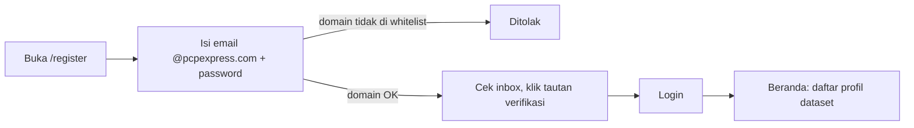
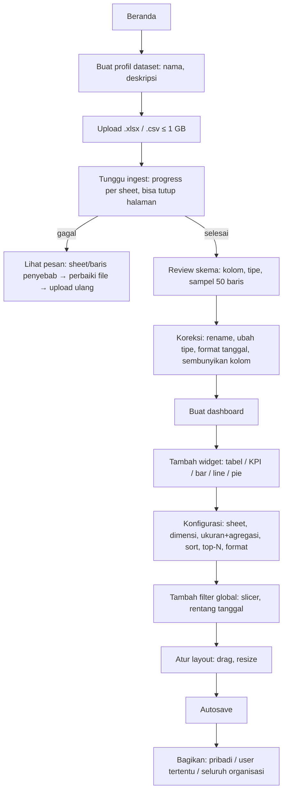
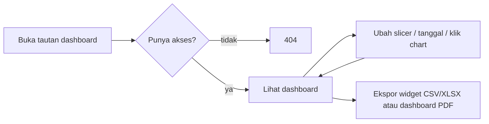
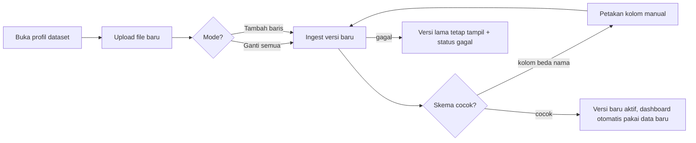
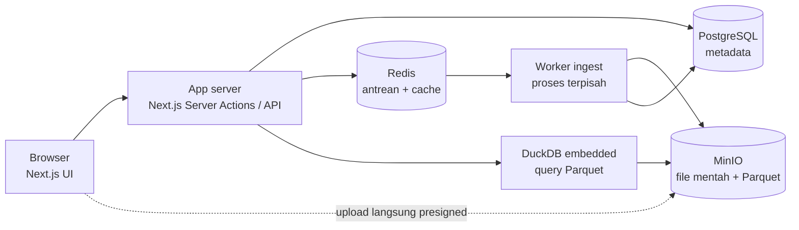
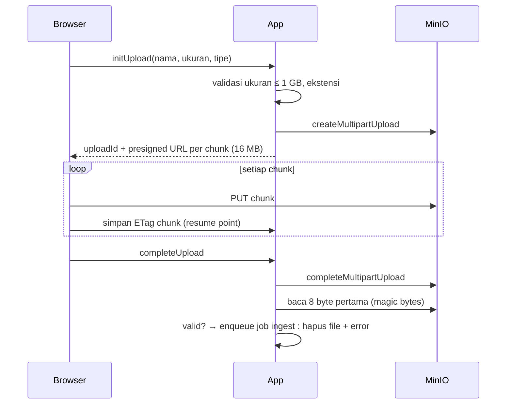
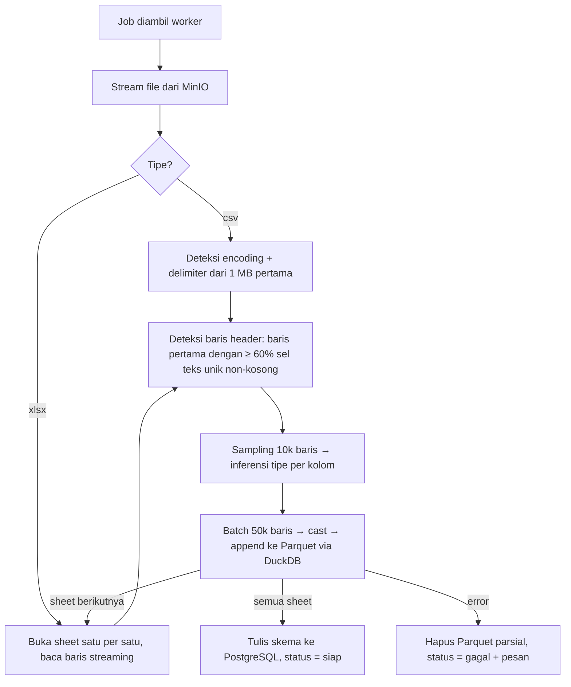
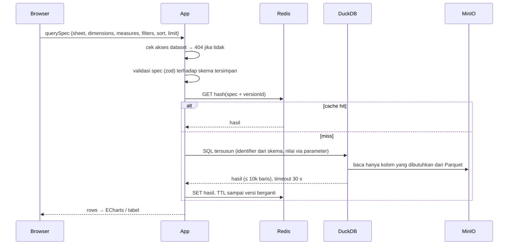

# Flow Kerja — Data Dashboard (acuan)

Dokumen acuan untuk produk dan implementasi. Dua sudut pandang: (A) apa yang dilakukan user, (B) apa yang terjadi di dalam aplikasi. Referensi task ada di `docs/ai/tasks/`.

---

## A. Flow kerja user

### A1. Onboarding (sekali)


### A2. Dari file Excel ke dashboard (alur utama)


Padanan konsep Excel → aplikasi:

| Excel | Aplikasi |
|---|---|
| Workbook | Profil dataset |
| Sheet | Sheet (tabel Parquet) |
| Pivot table | Widget tabel/chart dengan dimensi + ukuran |
| Slicer / timeline | Filter global (slicer, rentang tanggal) |
| Klik pivot untuk filter pivot lain | Cross-filter antar widget |
| Formula agregasi (SUMIFS, COUNTIFS) | Agregasi di widget (sum, avg, count, distinct) |
| Kirim file via WA/email | Bagikan tautan dashboard; ekspor CSV/XLSX/PDF |
| Ganti data → formula rusak | Upload ulang (replace/append) → widget tetap jalan |

### A3. Pemakaian harian (viewer)


### A4. Refresh data bulanan


Peran:
- **Pemilik dataset**: upload, skema, buat/hapus dashboard, atur akses.
- **Editor**: ubah widget dan layout dashboard yang dibagikan.
- **Viewer**: lihat, filter, ekspor.

---

## B. Flow kerja aplikasi

### B1. Komponen


Pembagian tanggung jawab:
- **PostgreSQL** hanya metadata: user, profil dataset, versi, skema kolom, dashboard, widget, akses, job. Tidak pernah menyimpan baris data Excel.
- **MinIO**: `raw/<datasetId>/<versionId>/file.xlsx` (dihapus setelah 7 hari) dan `parquet/<datasetId>/<versionId>/<sheet>.parquet` (dipertahankan).
- **Worker**: proses Node terpisah dengan batas memori; satu-satunya yang membaca file mentah.
- **DuckDB**: embedded di app server, membaca Parquet langsung dari MinIO (httpfs/S3), tidak ada server DB tambahan.

### B2. Upload (T-004)


### B3. Ingest (T-005, T-006)


Aturan tipe: kolom dengan ≥ 98% nilai parse sebagai angka → angka, sisanya dicatat sebagai baris bermasalah; tanggal dicoba dengan daftar format Indonesia (`dd/mm/yyyy`, `dd-mm-yyyy`, serial Excel, ISO); campuran → teks (user bisa koreksi di T-006). Memori terikat pada ukuran batch, bukan ukuran file.

### B4. Query widget (T-007, T-009)


Satu slicer = satu query `SELECT DISTINCT kolom LIMIT 1000` + pencarian server-side. Satu klik filter = N widget mengirim spec baru; cache membuat filter yang sama dari user lain instan.

### B5. Siklus hidup versi dataset (T-011)
```
kosong → ingesting → siap ──upload ulang──► ingesting(v2) → siap(v2 aktif, v1 disimpan)
                      │                          │
                      └── gagal (tetap kosong)   └── gagal (v1 tetap aktif)
```
Dashboard selalu menunjuk `activeVersionId`. Ganti versi = ganti satu pointer + invalidasi cache Redis. Tiga versi terakhir dipertahankan untuk rollback.

---

## C. Kenapa tidak akan "seberat Excel" — dan risiko yang tetap ada

### Kenapa Excel berat pada 1 GB
1. Seluruh workbook dimuat ke RAM dan di-dekompresi (xlsx = XML zip; 1 GB file ≈ 5–10 GB di memori).
2. Pivot + slicer membangun *pivot cache* in-memory dan menghitung ulang setiap kali slicer berubah, sebagian besar single-thread.
3. Formula (SUMIFS dll.) dihitung ulang untuk semua sel saat data berubah.
4. Batas 1.048.576 baris per sheet; data besar terpaksa dipecah ke banyak sheet dan dijahit formula.

### Kenapa aplikasi berbeda
1. **Parse sekali, bukan setiap kali.** Biaya berat (baca XML 1 GB) dibayar satu kali saat ingest di worker, bukan saat user klik slicer.
2. **Parquet kolumnar + terkompresi.** 1 GB xlsx biasanya menjadi 100–300 MB Parquet. Query hanya membaca kolom yang dipakai widget (misal 3 dari 25 kolom), bukan seluruh tabel.
3. **DuckDB vektorisasi multi-core.** Group-by 2 dimensi + 2 ukuran pada 8–10 juta baris umumnya ratusan milidetik sampai ~2 detik pada 4 vCPU. Tidak ada "pivot cache" yang dibangun ulang.
4. **Cache hasil.** Kombinasi filter yang sama (termasuk dari user lain) dijawab dari Redis tanpa menyentuh data.
5. **Tidak ada formula sel.** Agregasi dihitung di mesin query, bukan dirantai antar sel.
6. **Browser hanya menerima hasil agregasi** (ratusan–ribuan baris), tidak pernah 8 juta baris.

### Risiko yang tetap ada dan mitigasinya
| Risiko | Dampak | Mitigasi (task) |
|---|---|---|
| Ingest 1 GB xlsx lambat (parse XML di Node) | User menunggu 5–15 menit sekali per upload | Worker async + progress per sheet; benchmark ExcelJS stream vs DuckDB `read_xlsx` vs calamine di T-005, pilih tercepat |
| Banyak user klik filter bersamaan di satu VM | Query antre, p95 naik | Cache Redis, batas paralel DuckDB, timeout 30 s, prewarm cache saat dashboard dibuka (T-007, T-015) |
| Slicer pada kolom kardinalitas tinggi (100k+ nilai unik, misal no. resi) | Dropdown berat | Batasi 1000 nilai + pencarian server-side; peringatkan user (T-010) |
| Widget tabel baris mentah | Transfer besar | Paginasi server 100 baris, sort di DuckDB (T-009) |
| Spek VM kurang | Semua lambat | Minimum 4 vCPU, 16 GB RAM, SSD; worker dibatasi 3 GB (T-014) |
| File > ratusan juta baris total | DuckDB single-node mulai berat | Di luar scope v1; Parquet memungkinkan pindah ke ClickHouse tanpa re-ingest (ADR-0001) |

### Kesimpulan
Memungkinkan, dan pengalaman slicer akan **jauh lebih ringan dari Excel** karena pekerjaan berat dipindah ke ingest sekali jalan dan query hanya menyentuh kolom yang dibutuhkan. Bagian yang tetap "berat" hanya ingest awal, dan itu berjalan di latar belakang. Angka target (ingest < 15 menit, p95 query < 3 detik pada 10 juta baris) dibuktikan di T-015 dengan fixture 1 GB sebelum dianggap selesai.
