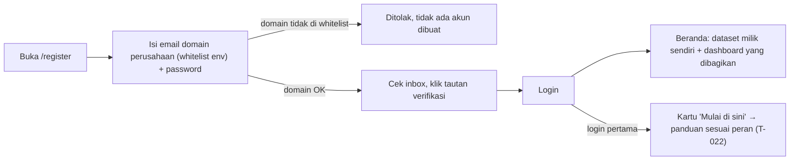
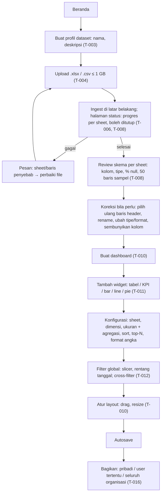
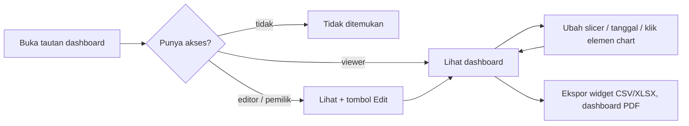
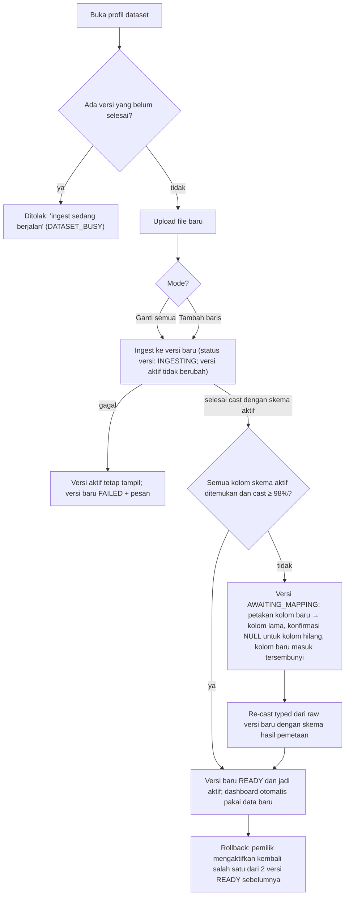
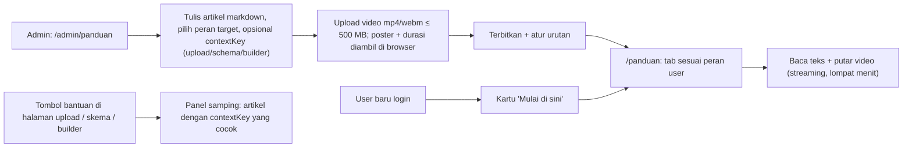
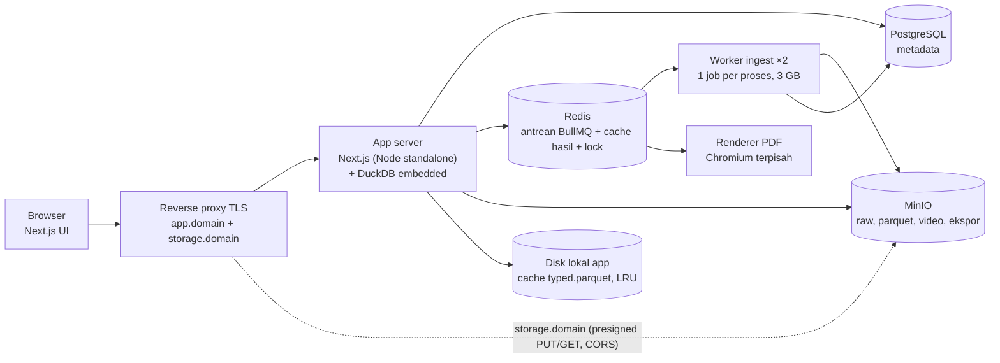
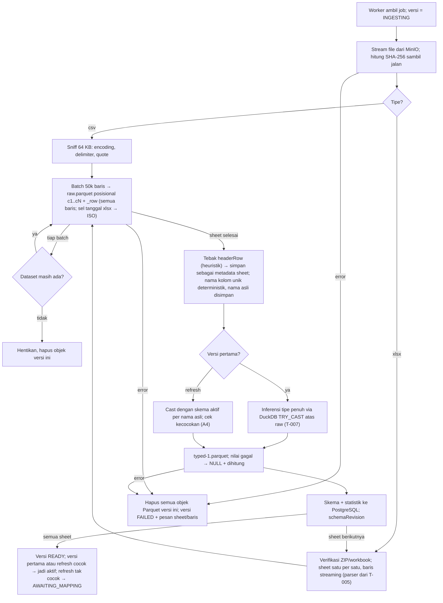

# Flow Kerja — Data Dashboard (acuan)

Dokumen acuan produk dan implementasi. (A) apa yang dilakukan user, (B) apa yang terjadi di aplikasi, (C) kenapa tidak seberat Excel, (D) daftar keputusan yang mengikat. Setiap bagian menyebut task di `docs/ai/tasks/`. Jika implementasi harus menyimpang, perbarui dokumen ini dulu dan catat ADR.

Revisi 3 (2026-10-11) setelah review adversarial: revisi skema per sheet (`schemaRevision`) agar re-cast tidak merusak cache/file yang sedang dibaca; versi self-contained untuk mode tambah baris; dua enum status (versi vs profil); urutan inferensi tipe diperbaiki; worker 1 job per proses; keputusan auth (Credentials + JWT + `sessionVersion`); MinIO di subdomain sendiri; otorisasi query berbasis widget; header sebagai metadata (tanpa parse ulang); batas sumber daya; pemecahan task menjadi 24.

---

## Peran

| Peran | Melekat pada | Boleh |
|---|---|---|
| **Admin** | User (`isAdmin`); seed pertama T-001, selanjutnya T-019 | Kelola pengguna, kelola konten panduan. Tidak otomatis membuka dataset orang lain |
| **Pemilik dataset** | Dataset (`ownerId`) | Upload, skema, refresh, buat/hapus dashboard, atur akses dashboard |
| **Editor** | Share dashboard | Ubah widget, filter, layout dashboard itu. Tidak bisa upload/ubah skema |
| **Viewer** | Share dashboard, atau seluruh organisasi | Lihat, filter, ekspor |

- **Organisasi** = seluruh user aktif pada instance ini (single-tenant on-prem), apa pun domain emailnya. Tidak ada tenant/workspace lain.
- Objek yang tidak boleh diakses dijawab **tidak ditemukan** (Route Handler: HTTP 404; Server Action: `{ ok:false, code:'NOT_FOUND' }`). Aksi tulis oleh user yang boleh melihat tetapi tidak boleh mengubah dijawab `FORBIDDEN` (HTTP 403 pada Route Handler).
- Peran untuk tab panduan diturunkan: admin = `isAdmin`; pemilik = punya ≥ 1 dataset **atau user baru tanpa dataset** (default); editor/viewer = punya share dengan peran itu.

---

## A. Flow kerja user

### A1. Onboarding (sekali) — T-002

Domain dari env `ALLOWED_EMAIL_DOMAINS` (boleh lebih dari satu). Login dibatasi 10 percobaan gagal per IP per 10 menit; IP dibaca dari `X-Forwarded-For` hanya jika `TRUST_PROXY=true`.

### A2. Dari file Excel ke dashboard (alur utama) — T-003..T-012
Semua layar di bawah dibangun lewat plugin frontend-expert di atas fondasi UI T-025 (arah desain, token preset, app shell, ikon Tabler sebagai waiver Reicon); lihat `docs/ai/conventions.md` baris UI dan `docs/ai/design-system.md` setelah T-025 selesai.

Dashboard boleh dibuat sebelum ingest selesai; widget baru bisa dikonfigurasi setelah skema tersedia.

Padanan konsep Excel → aplikasi:

| Excel | Aplikasi |
|---|---|
| Workbook | Profil dataset |
| Sheet | Sheet (tabel Parquet) |
| Pivot table | Widget tabel/chart dengan dimensi + ukuran |
| Slicer / timeline | Filter global (slicer, rentang tanggal) |
| Klik pivot untuk filter pivot lain | Cross-filter antar widget |
| SUMIFS / COUNTIFS | Agregasi di widget (sum, avg, count, count distinct, min, max) |
| Kirim file via WA/email | Bagikan tautan dashboard; ekspor CSV/XLSX/PDF |
| Ganti data → formula rusak | Upload ulang (ganti/tambah) → widget tetap jalan |

### A3. Pemakaian harian (viewer / editor) — T-012, T-016, T-017, T-018

Filter aktif tersimpan di URL.

### A4. Refresh data — T-013 (ganti + rollback), T-014 (pemetaan), T-015 (tambah baris)

- **Versi refresh tidak menjalankan inferensi tipe.** Raw versi baru di-cast memakai **skema aktif** (dipetakan per nama asli kolom setelah normalisasi spasi/kapital). Dengan itu koreksi user (tipe dipaksa, format tanggal, rename) ikut terbawa.
- **Ganti semua**: raw versi baru = isi file baru.
- **Tambah baris**: raw versi baru = raw versi aktif ∪ raw file baru, ditulis worker dalam satu `COPY` DuckDB. Setiap versi **self-contained**; menghapus versi lama tidak pernah merusak versi lain.
- Satu dataset hanya punya **satu versi non-terminal** pada satu waktu.
- Disimpan 3 versi READY terakhir; yang lebih lama dihapus (metadata + Parquet) oleh job pembersihan.

### A5. Panduan penggunaan per peran — T-020, T-021, T-022


### A6. Administrasi pengguna — T-019
`/admin/pengguna`: daftar user (email, admin?, aktif?, login terakhir), jadikan/cabut admin, nonaktifkan/aktifkan, alihkan kepemilikan dataset user nonaktif ke user lain. Tidak boleh menonaktifkan diri sendiri atau admin aktif terakhir. Nonaktif → `sessionVersion` dinaikkan → semua sesi user itu tidak valid pada permintaan berikutnya.

---

## B. Flow kerja aplikasi

### B1. Komponen — T-001, T-023

- **PostgreSQL** hanya metadata. Tidak pernah menyimpan baris data Excel.
- **MinIO** (S3 API) di **subdomain sendiri** (`storage.<domain>`), bukan path prefix: SigV4 menandatangani host + path, jadi S3 client app menandatangani dengan `S3_PUBLIC_ENDPOINT` yang persis dilihat browser. Bucket lifecycle: `AbortIncompleteMultipartUpload` 1 hari. CORS: origin app, metode PUT/GET, `ExposeHeaders: ETag`. Tata letak objek:
  - `raw/<datasetId>/<versionId>/source.<xlsx|csv>` — file asli; dihapus 7 hari sejak `ingestFinishedAt` (sukses maupun gagal).
  - `parquet/<datasetId>/<versionId>/<sheetId>/raw.parquet` — kolom posisional `c1..cN` VARCHAR + `_row`; **semua baris termasuk di atas header**; dipertahankan selama versi ada.
  - `parquet/<datasetId>/<versionId>/<sheetId>/typed-<schemaRevision>.parquet` — bertipe; dibaca widget. Revisi baru = file baru; file lama dihapus 1 jam setelah pointer berpindah.
  - `guides/<articleId>/<videoId>.<mp4|webm>` dan `guides/<articleId>/<videoId>-poster.png`.
  - `exports/<userId>/<jobId>.<csv|xlsx|pdf>` — dihapus job pembersihan setelah 1 jam (lifecycle MinIO hanya granularitas hari); unduh lewat `GET /api/exports/<id>/download` yang mengecek pemilik lalu 302 ke presigned 5 menit `attachment`.
- **Worker**: proses Node terpisah, **concurrency BullMQ = 1 per proses**, 2 replika @ 3 GB. DuckDB di worker: `memory_limit='1GB'`, `threads=2`, `temp_directory` di disk.
- **DuckDB di app**: membaca `typed-<rev>.parquet`; salinan di disk lokal dengan batas `MAX_LOCAL_PARQUET_BYTES` (LRU evict); fallback S3 httpfs. `memory_limit` app = 2 GB.
- **Renderer**: proses terpisah berisi Chromium untuk PDF; hanya di network frontend (tidak bisa mencapai MinIO/Redis/PostgreSQL); dipanggil app dengan header `RENDERER_SECRET`; membuka `APP_INTERNAL_URL/render/<token>` sendiri; route allowlist hanya origin app; non-root + seccomp.
- **Jaringan compose**: hanya reverse proxy mempublikasikan port; Redis `requirepass`; app/worker memakai service account MinIO berpolicy prefix; proxy `storage.<domain>` hanya meneruskan PUT/GET/HEAD/OPTIONS bertanda tangan ke prefix `raw|guides|exports`, memblokir `/minio/*`, dan menambahkan `nosniff` + `CSP: sandbox`.

### B2. Upload — T-004
```mermaid
sequenceDiagram
  participant B as Browser
  participant A as App
  participant P as PostgreSQL
  participant M as MinIO
  participant RD as Redis
  B->>B: pra-cek UX (64 KB pertama): xlsx = ZIP 'PK' — csv = teks tanpa NUL, BOM UTF-16 ditolak
  B->>A: initUpload(datasetId, nama, ukuran, tipe, fingerprint)
  A->>P: tolak bila dataset punya versi non-terminal (DATASET_BUSY)
  A->>A: tolak bila ukuran > MAX_UPLOAD_BYTES atau ekstensi bukan .xlsx/.csv
  A->>P: cari upload belum selesai dengan (userId, datasetId, fingerprint) sama
  alt ada
    A-->>B: uploadId + part yang sudah ber-ETag (resume)
  else baru
    A->>P: buat DatasetVersion status UPLOADING
    A->>M: createMultipartUpload
    A-->>B: uploadId + presigned URL per part dengan Content-Length sebagai signed header; ContentType ditetapkan server
  end
  loop setiap part yang belum selesai
    B->>M: PUT part (presigned)
    M-->>B: ETag
    B->>A: catat ETag part
  end
  B->>A: completeUpload
  A->>M: ListParts — abort bila jumlah part ≠ yang diterbitkan atau ada part > 16 MiB (kecuali part terakhir)
  A->>M: completeMultipartUpload
  A->>M: HeadObject — ukuran nyata ≤ MAX_UPLOAD_BYTES
  A->>M: GetObject range 0–64 KB — xlsx: signature ZIP — csv: teks tanpa NUL, BOM UTF-16 ditolak
  alt valid
    A->>P: versi UPLOADED, simpan ETag multipart
    A->>RD: enqueue job ingest(versionId)
  else tidak valid
    A->>M: DeleteObject
    A->>P: versi FAILED
    A-->>B: code 'INVALID_FORMAT'
  end
```
Catatan kebenaran:
- **CSV tidak punya magic bytes.** Validasi = teks tanpa byte NUL di 64 KB pertama, encoding UTF-8 atau Windows-1252 (BOM UTF-16 → ditolak dengan pesan "simpan ulang sebagai UTF-8"), parser membaca ≥ 1 baris. xlsx = ZIP yang memuat `xl/workbook.xml`; struktur penuh diverifikasi worker saat membuka.
- `Content-Length` disertakan sebagai signed header pada presigned `UploadPart` sehingga MinIO menolak part berukuran lain; `ListParts` sebelum complete dan HeadObject adalah lapisan kedua dan ketiga. `ContentType` objek selalu ditetapkan server, tidak pernah dari klien. Tidak pernah ada presigned GET untuk `raw/` atau `parquet/`.
- ETag multipart bukan checksum isi; SHA-256 isi dihitung worker saat streaming (T-006) dan disimpan di versi.
- Fingerprint = `nama + ukuran + lastModified`, selalu di-scope `(userId, datasetId)`.
- Upload yang tidak selesai 24 jam → versi FAILED oleh job terjadwal; objek multipart dibersihkan lifecycle bucket.

### B3. Ingest — T-005 (spike parser), T-006 (raw), T-007 (typed)

- **Idempoten**: job yang diulang (stalled/retry/worker dibunuh) menghapus objek Parquet versi itu lebih dulu lalu mengulang dari awal; hasil akhir identik.
- **Header sebagai metadata.** Karena raw menyimpan semua baris posisional, memilih ulang baris header (T-008) hanya mengubah `headerRow` + peta nama lalu re-cast (`WHERE _row > headerRow`). Tidak ada parse ulang file asli, tidak bergantung retensi 7 hari.
- **Nama kolom**: header kosong → `kolom_<posisi>`; duplikat → `Total`, `Total_2`; nama asli (apa adanya, termasuk `"`/`;`/newline) tetap tersimpan dan dipakai saat memetakan versi refresh.
- **Urutan inferensi tipe** (per kolom, atas seluruh baris data, bukan sampel): bilangan bulat → desimal → tanggal/waktu (pola teks `dd/mm/yyyy`, `dd-mm-yyyy`, `yyyy-mm-dd`, `dd/mm/yyyy HH:mm`, ISO 8601) → boolean **hanya untuk literal** `true/false/ya/tidak/yes/no` (bukan 0/1) → teks. Terpilih bila ≥ 98% nilai non-kosong lolos. Sel bertipe tanggal di xlsx sudah diserialisasi ISO oleh parser, jadi "serial Excel" **hanya** tersedia sebagai override manual di T-008.
- **Locale angka** per kolom: bila ada `,` sebagai desimal atau pola `\.\d{3}(\.|$)` → Indonesia (`1.234.567,89`), selain itu US; disimpan `numberLocale` di skema. Tipe desimal = `DECIMAL(38,6)`.
- **Tanggal naive**: nilai tanggal dataset disimpan `DATE`/`TIMESTAMP` tanpa zona dan **tidak pernah digeser**. Aturan "UTC di DB" di conventions hanya untuk kolom metadata PostgreSQL.
- `typed` selalu ditulis sebagai `typed-<rev>.parquet` baru; pointer `schemaRevision` di PostgreSQL diganti setelah file lengkap (atomik). Re-cast dilindungi lock Redis `SET NX recast:<sheetId>`.
- Memori worker terikat batch + `memory_limit` DuckDB. Risiko diketahui: tabel shared strings xlsx dimuat utuh oleh sebagian parser; T-005 mengukur ini dengan fixture teks-berat dan menetapkan mitigasi (spill ke tabel DuckDB sementara) bila perlu.

### B4. Query widget — T-009 (API), T-011 (widget), T-012 (filter), T-016 (akses)
```mermaid
sequenceDiagram
  participant B as Browser
  participant A as App
  participant P as PostgreSQL
  participant R as Redis
  participant D as DuckDB
  participant S as Parquet (lokal / MinIO)
  B->>A: POST /api/query {widgetId, filters[]} — atau {datasetId, spec} khusus pemilik/editor saat mengonfigurasi
  A->>P: resolusi akses: widget → dashboard → share/pemilik; dataset → pemilik
  A-->>B: 404 bila tidak berhak
  A->>P: skema aktif (versi aktif + schemaRevision per sheet), cache memori per dataset, di-invalidate saat skema/versi berubah
  A->>A: spec efektif = spec tersimpan widget + filters client (hanya kolom filter yang diizinkan dashboard); validasi zod; agregasi sesuai tipe
  A-->>B: 400 bila spec tidak valid (tidak menyentuh DuckDB)
  A->>R: GET key = hash(datasetId, versionId, sheetId, schemaRevision, JSON kanonik spec)
  alt hit
    R-->>A: hasil
  else miss
    A->>A: SQL: identifier dikutip ganda dari skema, nilai via parameter binding
    A->>D: jalankan, timeout 30 s, slot paralel MAX_QUERY_CONCURRENCY
    D->>S: baca hanya kolom yang dirujuk dari typed-<rev>.parquet
    D-->>A: hasil ≤ 10k baris
    A->>R: SET hasil TTL 24 jam (Redis maxmemory + allkeys-lru)
  end
  A-->>B: rows → ECharts / tabel
```
- **Viewer tidak pernah mengirim spec bebas**: hanya `{widgetId, filters}`, spec dari widget tersimpan, filter dibatasi `allowedFilterColumns` dashboard. **Pemilik** boleh `{datasetId, spec}`. **Editor** boleh `{dashboardId, spec}`: authz = share EDITOR dashboard itu, dataset diturunkan server; editor dengan sengaja boleh membaca semua kolom tidak tersembunyi dataset, dan dialog share menampilkan peringatan itu. `sheetId` selalu di-resolve `where {id, datasetId}` sehingga spec tidak bisa menunjuk sheet dataset lain. Kolom sort/filter divalidasi terhadap kolom widget/dashboard, bukan seluruh skema.
- Key cache memuat `versionId` **dan** `schemaRevision`; perubahan versi atau re-cast otomatis miss tanpa penghapusan massal. Spec dikanonikkan (urut key, dedupe filter) sebelum di-hash.
- Slicer: `SELECT DISTINCT kolom ORDER BY 1 LIMIT 1000` + pencarian server-side; > 1000 nilai unik → peringatan.
- Tabel baris mentah: paginasi server 100 baris, `ORDER BY` + `LIMIT/OFFSET` di DuckDB.
- Ekspor tabular (T-017) memakai jalur sama tanpa batas 10k, maks 1 juta baris, sebagai job; unduh via presigned 1 jam. PDF (T-018) oleh renderer dengan **token render** sekali pakai (60 detik, terikat dashboardId + userId).

### B5. Status dan versi — T-003, T-013
Dua enum, keduanya di kode English:
- `DatasetVersion.status`: `UPLOADING → UPLOADED → INGESTING → READY | FAILED`, dan `INGESTING → AWAITING_MAPPING → READY` untuk refresh yang tidak cocok. Terminal: `READY`, `FAILED`.
- `Dataset` tidak punya kolom status; UI menurunkan label: **kosong** (tak ada versi READY), **siap** (ada `activeVersionId`), plus badge versi terbaru (`mengunggah` / `memproses` / `menunggu pemetaan` / `gagal: <pesan>`).

```
Versi pertama : UPLOADING → UPLOADED → INGESTING → READY (langsung aktif)
                                           └────→ FAILED (dataset tetap kosong)
Refresh       : UPLOADING → UPLOADED → INGESTING → READY (cocok → aktif)
                                           ├────→ AWAITING_MAPPING → READY (aktif)
                                           └────→ FAILED (versi aktif lama tidak berubah)
```
- Dashboard dan widget merujuk `datasetId` + `sheetId`; app menerjemahkan ke `activeVersionId` + `schemaRevision` saat query. Query yang sudah berjalan memakai nilai yang dibacanya di awal; file lama masih ada ≥ 1 jam setelah pointer berpindah, jadi tidak ada baca-korup.
- Rollback: pemilik mengaktifkan kembali salah satu dari 2 versi READY sebelumnya (T-013). Retensi 3 versi READY; sisanya dihapus beserta Parquet oleh job pembersihan.
- Hapus profil dataset: batalkan job BullMQ versi non-terminal, hapus semua versi, Parquet, file asli, dashboard, share (konfirmasi dua langkah).

### B6. Panduan — T-020, T-021, T-022
- Artikel: markdown di PostgreSQL, dirender server-side dengan sanitasi (HTML mentah tidak dieksekusi). Field: `role (owner|editor|viewer|admin|all)`, `contextKey? (upload|schema|builder)`, `order`, `status (draft|published)`.
- Video: multipart yang sama dengan B2 (≤ 500 MB, `mp4`/`webm`). Signature dicek dengan offset: mp4 `ftyp` di byte 4–8; webm `1A 45 DF A3`. Durasi dan poster diambil di **browser** (`loadedmetadata` + canvas → PNG kecil) sehingga tidak perlu ffmpeg. Diputar `<video>` HTML5 via presigned 1 jam; MinIO melayani `Range` → `206 Partial Content`.
- Filter: artikel published `WHERE role IN (<peran turunan user>, 'all')`; slug di luar itu → tidak ditemukan.

---

## C. Kenapa tidak akan "seberat Excel" — dan risiko yang tetap ada

### Kenapa Excel berat pada 1 GB
1. Seluruh workbook dimuat ke RAM dan di-dekompresi (xlsx = XML terkompresi; di memori berkali-kali lipat ukuran file).
2. Pivot + slicer membangun *pivot cache* di memori dan menghitung ulang setiap slicer berubah; jalur ini sebagian besar single-thread.
3. Formula dihitung ulang untuk semua sel yang bergantung saat data berubah.
4. Batas 1.048.576 baris per sheet; data besar dipecah ke banyak sheet dan dijahit formula.

### Kenapa aplikasi berbeda
1. **Parse sekali.** Biaya baca XML 1 GB dibayar sekali di worker, bukan tiap klik.
2. **Parquet kolumnar + terkompresi.** Perkiraan 1 GB xlsx → 100–300 MB typed (dibuktikan T-024). Query hanya membaca kolom yang dipakai widget.
3. **DuckDB vektorisasi multi-core.** Group-by 2 dimensi + 2 ukuran pada 8–10 juta baris umumnya ratusan ms sampai ~2 s di 4 vCPU (perkiraan; target p95 < 3 s diuji T-024).
4. **Cache hasil** lintas user.
5. **Tidak ada formula sel.**
6. **Browser hanya menerima agregasi**, bukan jutaan baris.

### Risiko yang tetap ada dan mitigasinya
| Risiko | Dampak | Mitigasi (task) |
|---|---|---|
| Parse xlsx 1 GB di Node lambat; shared strings dimuat utuh | Ingest 5–15 menit; RSS bisa melampaui 2 GB pada file teks-berat | Spike T-005 dengan fixture teks-berat, pilih parser, catat mitigasi; worker 1 job/proses, DuckDB `memory_limit` (T-006) |
| Banyak user klik filter bersamaan | p95 naik | Cache Redis, `MAX_QUERY_CONCURRENCY`, timeout 30 s, prewarm saat dashboard dibuka (T-009, T-024) |
| Parquet lewat jaringan ke MinIO | Latensi | Cache disk lokal LRU dengan batas byte (T-009) |
| Slicer kardinalitas tinggi | Dropdown berat | LIMIT 1000 + pencarian server (T-012) |
| Inferensi tipe salah / locale desimal | Angka salah 1000× atau jadi teks | Inferensi penuh, deteksi locale per kolom, koreksi user tanpa parse ulang (T-007, T-008) |
| Re-cast saat query berjalan | Baca file korup | typed per revisi, pointer atomik, file lama ditahan 1 jam (T-007, T-008) |
| Upload nakal melebihi 1 GB | Storage penuh | ListParts sebelum complete, HeadObject, lifecycle abort 1 hari, kuota per user (T-004, T-024) |
| Redis / disk lokal tumbuh tanpa batas | Layanan mati | `maxmemory allkeys-lru`, LRU parquet lokal, lifecycle ekspor 1 jam (T-009, T-023) |
| Spek VM kurang | Semua lambat | Min 4 vCPU, 16 GB RAM, SSD; app 4 GB, worker 2×3 GB, renderer 2 GB (T-023) |
| Total data > ratusan juta baris | DuckDB single-node berat | Di luar v1; Parquet portabel ke ClickHouse (ADR-0001) |

### Kesimpulan
Memungkinkan, dan slicer akan jauh lebih ringan dari Excel karena pekerjaan berat dipindah ke ingest sekali jalan dan query hanya menyentuh kolom yang dibutuhkan. Yang tetap berat hanya ingest awal, di latar belakang. Angka target adalah perkiraan sampai T-024 membuktikannya.

---

## D. Keputusan mengikat (ringkas)

| # | Keputusan | Alasan |
|---|---|---|
| D1 | Auth: Credentials (email + password, argon2id) + JWT session; klaim `sessionVersion`; setiap permintaan middleware mencocokkan `isActive` dan `sessionVersion` dengan DB | Auth.js Credentials memaksa JWT, tidak ada sesi DB yang bisa dicabut; cek per permintaan memberi pencabutan seketika (T-002, T-019) |
| D2 | Server Action mengembalikan `{ ok:false, code }` dengan `NOT_FOUND`/`FORBIDDEN`/`RATE_LIMITED`/`DATASET_BUSY`/`INVALID_FORMAT`; HTTP status hanya di Route Handler | Server Action tidak punya status HTTP (conventions) |
| D3 | Parquet dua lapis per sheet; raw posisional semua baris; typed per `schemaRevision`; header = metadata | Re-cast tanpa file asli, tanpa parse ulang, tanpa korupsi baca |
| D4 | Versi self-contained; refresh di-cast dengan skema aktif, tanpa inferensi; satu versi non-terminal per dataset | Append + retensi aman; koreksi user terbawa; tidak ada balapan upload |
| D5 | MinIO di subdomain sendiri; S3 client menandatangani dengan endpoint publik | SigV4 menyertakan host + path |
| D6 | Viewer hanya `{widgetId, filters}`; editor `{dashboardId, spec}`; pemilik `{datasetId, spec}`; sheet selalu di-resolve dalam dataset dashboard | Viewer tidak boleh membaca kolom di luar widget; tidak ada baca lintas dataset |
| D7 | Worker 1 job/proses × 2 replika @ 3 GB; DuckDB `memory_limit` eksplisit di setiap proses | Hindari OOM-kill |
| D8 | Tanggal dataset naive, tidak digeser zona; preset dihitung Asia/Jakarta sebagai naive | Tanggal Excel tidak bertimezone |
| D9 | AC performa = bukti manual via `npm run perf` + laporan `docs/ai/perf/<task>.md`; `npm run check` memakai fixture kecil (≤ 50k baris) | Check CI harus cepat dan deterministik |
| D10 | Fixture: xlsx 1 GB = 3 sheet × 1 juta baris × ~30 kolom (teks-berat); CSV 1 GB ≈ 8 juta baris untuk target query 10 juta baris | Excel maks 1.048.576 baris/sheet |
| D11 | Format Rupiah `Rp 1.234.568` dengan spasi biasa (formatter mengganti U+00A0) | Test deterministik |
| D12 | Poster/durasi video diambil di browser; tidak ada ffmpeg di stack | Jaga image kecil |
| D14 | Keamanan dasar: CSP nonce + header (T-027), requireUser()/requireAdmin() Node-side di setiap Server Action/Route Handler dengan `isAdmin` dari DB, lupa/ganti password dengan token hash sekali pakai (T-026), AuditLog untuk share/admin/ekspor/hapus, batas parser (baris/kolom/sheet/sel/rasio dekompresi/timeout), CSV formula-injection dinetralkan, markdown allowlist, task security berprofil strict dengan checklist ASVS | Hasil review ASVS/STRIDE 2026-10-11 |
| D13 | UI hanya lewat rantai plugin frontend-expert; fondasi (arah, token preset, shell) ditetapkan sekali di T-025; setiap task UI lolos `/frontend-expert:audit` tanpa Critical/High dan mencatat Conventions check dengan waiver Icons = @tabler/icons-react | Konsistensi visual, anti "AI aesthetic", kebijakan ikon user |
