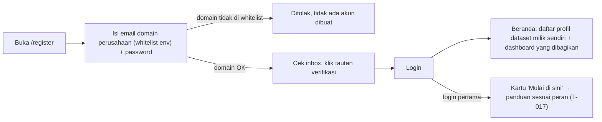
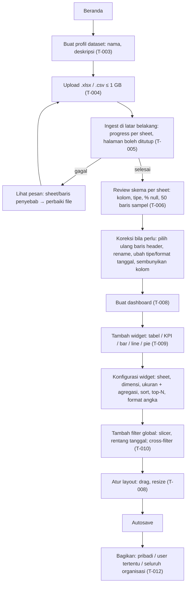
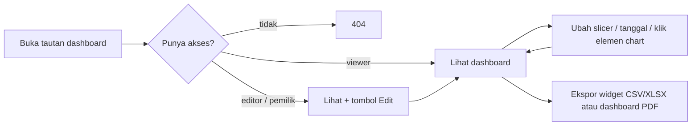
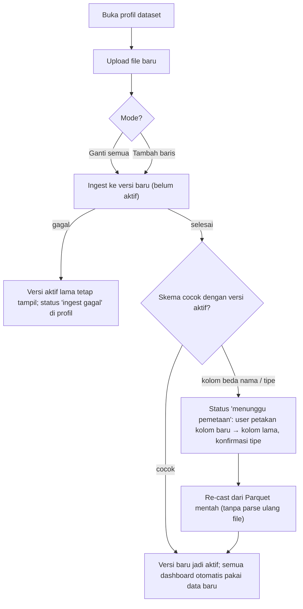
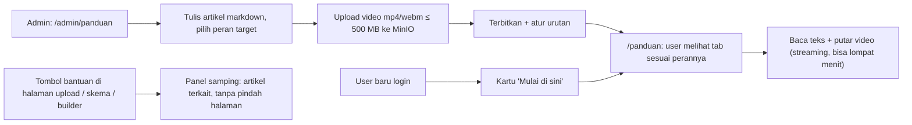
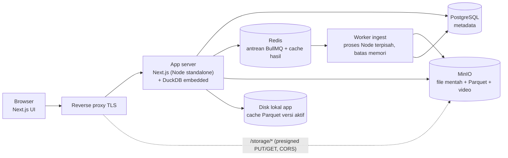
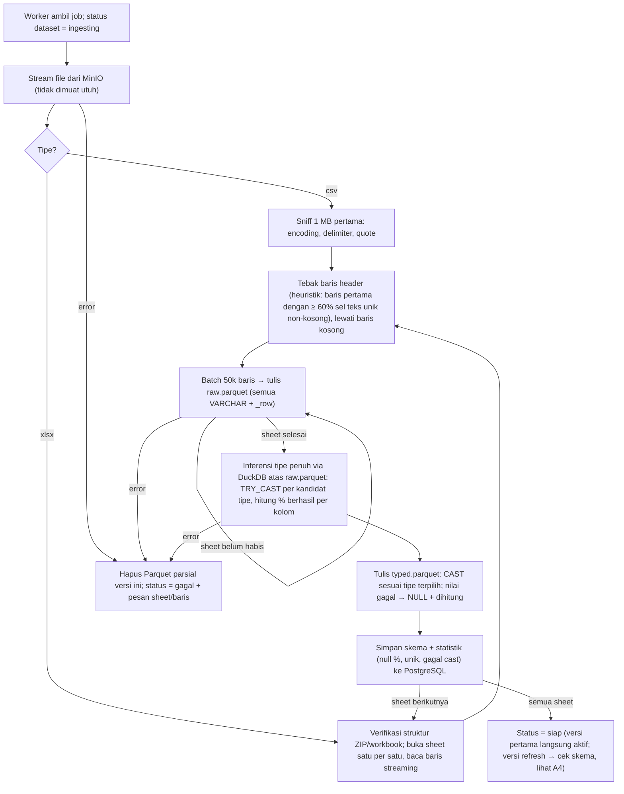

# Flow Kerja — Data Dashboard (acuan)

Dokumen acuan untuk produk dan implementasi. Dua sudut pandang: (A) apa yang dilakukan user, (B) apa yang terjadi di dalam aplikasi. Setiap bagian menyebut task terkait di `docs/ai/tasks/`. Jika implementasi harus menyimpang dari dokumen ini, perbarui dokumen ini dulu dan catat di ADR.

Revisi 2 (2026-10-11): koreksi alur refresh data (pemetaan kolom sebelum versi aktif, tanpa parse ulang), validasi upload (CSV tidak punya magic bytes), penyimpanan Parquet mentah + bertipe (re-cast tanpa file asli), inferensi tipe penuh via DuckDB (bukan sampling), cache per versi, peran admin.

---

## Peran

| Peran | Siapa | Boleh |
|---|---|---|
| **Admin** | Ditetapkan lewat seed awal (T-001) lalu lewat halaman admin (T-018) | Kelola pengguna (daftar, jadikan admin, nonaktifkan), kelola konten panduan (T-016). Tidak otomatis bisa membuka dataset orang lain. |
| **Pemilik dataset** | User yang membuat profil dataset | Upload, koreksi skema, refresh data, buat/hapus dashboard, atur akses dashboard |
| **Editor** | User yang diberi akses editor pada sebuah dashboard | Ubah widget, filter, dan layout dashboard tersebut. Tidak bisa upload/ubah skema |
| **Viewer** | User yang diberi akses viewer, atau seluruh organisasi bila dashboard dibuka untuk organisasi | Lihat, filter, ekspor |

Peran admin melekat pada user. Peran pemilik/editor/viewer melekat per dataset/dashboard; satu user bisa pemilik di dataset A dan viewer di dashboard B. Semua pemeriksaan hak dilakukan di server; objek yang tidak boleh diakses menjawab 404, bukan 403 (agar keberadaannya tidak bocor), kecuali aksi edit oleh viewer yang sah menjawab 403 (T-012).

---

## A. Flow kerja user

### A1. Onboarding (sekali) — T-002

Domain yang diizinkan dibaca dari env `ALLOWED_EMAIL_DOMAINS` (bisa lebih dari satu). Login dibatasi 10 percobaan gagal per IP per 10 menit.

### A2. Dari file Excel ke dashboard (alur utama) — T-003..T-010

Dashboard boleh dibuat sebelum ingest selesai (T-008 hanya bergantung pada profil dataset), tetapi widget baru bisa dikonfigurasi setelah skema tersedia.

Padanan konsep Excel → aplikasi:

| Excel | Aplikasi |
|---|---|
| Workbook | Profil dataset |
| Sheet | Sheet (tabel Parquet) |
| Pivot table | Widget tabel/chart dengan dimensi + ukuran |
| Slicer / timeline | Filter global (slicer, rentang tanggal) |
| Klik pivot untuk filter pivot lain | Cross-filter antar widget |
| Formula agregasi (SUMIFS, COUNTIFS) | Agregasi di widget (sum, avg, count, count distinct, min, max) |
| Kirim file via WA/email | Bagikan tautan dashboard; ekspor CSV/XLSX/PDF |
| Ganti data → formula rusak | Upload ulang (ganti/tambah) → widget tetap jalan |

### A3. Pemakaian harian (viewer / editor) — T-010, T-012, T-013

Filter aktif tersimpan di URL, sehingga tautan yang disalin membawa filter yang sama.

### A4. Refresh data bulanan — T-011

- **Ganti semua**: versi baru berisi hanya data file baru.
- **Tambah baris**: versi baru = baris versi aktif + baris file baru (digabung di tahap Parquet, file lama tidak dibaca ulang).
- Pemetaan kolom tidak mengulang parse file 1 GB; ia hanya menulis ulang Parquet bertipe dari Parquet mentah (lihat B3).
- Sampai user menyelesaikan pemetaan, dashboard tetap menampilkan versi aktif lama.

### A5. Panduan penggunaan per peran — T-016, T-017

Peran target `all` tampil untuk semua user. Artikel peran lain tidak bisa diakses lewat slug langsung (404).

### A6. Administrasi pengguna — T-018
Admin membuka `/admin/pengguna`: daftar user (email, peran, status, login terakhir), jadikan/cabut admin, nonaktifkan akun (sesi langsung putus, login ditolak; dataset dan dashboard miliknya tetap ada dan bisa dialihkan ke pemilik lain). Admin tidak bisa menonaktifkan dirinya sendiri atau admin terakhir.

---

## B. Flow kerja aplikasi

### B1. Komponen — T-001, T-014


Pembagian tanggung jawab:
- **PostgreSQL** hanya metadata: user, profil dataset, versi, skema kolom, dashboard, widget, akses, job ingest, artikel panduan. Tidak pernah menyimpan baris data Excel.
- **MinIO** (akses S3 API). Tata letak objek:
  - `raw/<datasetId>/<versionId>/source.<xlsx|csv>` — file asli; dihapus 7 hari setelah ingest sukses.
  - `parquet/<datasetId>/<versionId>/<sheet>/raw.parquet` — semua kolom VARCHAR apa adanya + nomor baris; **dipertahankan** selama versi ada (sumber untuk re-cast).
  - `parquet/<datasetId>/<versionId>/<sheet>/typed.parquet` — kolom sudah bertipe sesuai skema aktif; yang dibaca widget.
  - `guides/<articleId>/<videoId>.mp4` — video panduan.
- **Worker**: proses terpisah dari app, satu-satunya yang membaca file mentah. Paralel maksimal 2 job (T-015).
- **DuckDB**: embedded di proses app, membaca `typed.parquet`. Versi aktif disalin ke disk lokal app saat pertama dibutuhkan agar query tidak bergantung latensi jaringan ke MinIO; jika tidak ada di lokal, baca via S3 (httpfs).
- **Reverse proxy** mengekspos app dan MinIO di satu domain HTTPS; MinIO wajib diset CORS mengizinkan `PUT`/`GET` dari origin app dan `ExposeHeaders: ETag` (dibutuhkan B2).

### B2. Upload — T-004
```mermaid
sequenceDiagram
  participant B as Browser
  participant A as App
  participant P as PostgreSQL
  participant M as MinIO
  B->>B: cek 4 byte pertama (xlsx harus 'PK\x03\x04'); csv: 1 MB pertama tanpa byte NUL — hanya UX, bukan keamanan
  B->>A: initUpload(nama, ukuran, tipe, fingerprint = nama+ukuran+lastModified)
  A->>A: tolak jika ukuran > MAX_UPLOAD_BYTES atau ekstensi bukan .xlsx/.csv
  A->>P: cari upload belum selesai dengan fingerprint sama (resume)
  alt ada
    A-->>B: uploadId lama + daftar part yang sudah punya ETag
  else baru
    A->>M: createMultipartUpload
    A->>P: simpan uploadId, status 'uploading'
    A-->>B: uploadId + presigned URL untuk tepat ceil(ukuran/16 MB) part
  end
  loop setiap part yang belum selesai (16 MB)
    B->>M: PUT part (presigned)
    M-->>B: ETag
    B->>A: catat ETag part (checkpoint resume)
  end
  B->>A: completeUpload
  A->>M: completeMultipartUpload(daftar part + ETag)
  A->>M: HeadObject → ukuran nyata harus ≤ MAX_UPLOAD_BYTES
  A->>M: GetObject range 0–4 KB (xlsx: signature ZIP; csv: teks tanpa NUL, encoding terdeteksi)
  alt valid
    A->>P: status 'uploaded', hitung checksum dari ETag multipart
    A->>RD: enqueue job ingest
  else tidak valid
    A->>M: DeleteObject
    A-->>B: error 'format tidak valid'
  end
```
Catatan kebenaran:
- **CSV tidak punya magic bytes.** Validasi CSV = teks (tanpa byte NUL di 1 MB pertama), encoding dikenali (UTF-8/UTF-16/Windows-1252), dan parser mampu membaca ≥ 1 baris. xlsx = file ZIP (`PK\x03\x04`) yang memuat entri `xl/workbook.xml`; ini dicek penuh oleh worker saat membuka file, bukan hanya 4 byte.
- Batas 1 GB ditegakkan dua kali: jumlah presigned URL yang diterbitkan dibatasi sesuai ukuran yang dideklarasikan (maks 64 part × 16 MB), dan ukuran nyata dicek dengan HeadObject setelah selesai.
- Pemeriksaan di browser hanya untuk pengalaman pengguna (gagal cepat). Semua keputusan keamanan ada di server.
- Upload yang tidak selesai dalam 24 jam dibersihkan (abort multipart) oleh job terjadwal.

### B3. Ingest — T-005, T-006

Aturan tipe (dihitung atas seluruh kolom, bukan sampel):
- Kandidat dicoba berurutan: boolean → bilangan bulat → desimal → tanggal/waktu → teks. Tipe dipilih jika ≥ 98% nilai non-kosong berhasil di-cast; nilai yang gagal menjadi NULL dan jumlahnya ditampilkan di halaman skema.
- Tanggal dicoba dengan daftar format: `dd/mm/yyyy`, `dd-mm-yyyy`, `yyyy-mm-dd`, `dd/mm/yyyy HH:mm`, serial Excel (angka hari sejak 1899-12-30), ISO 8601. Format yang lolos dicatat per kolom.
- Angka dengan pemisah ribuan titik dan desimal koma (`1.234.567,89`) dikenali sebagai desimal Indonesia.
- Kolom yang tidak mencapai 98% pada tipe mana pun → teks.
- **Koreksi user (T-006)**, termasuk memilih ulang baris header, rename, ubah tipe/format, atau pemetaan kolom saat refresh (T-011), **selalu menulis ulang `typed.parquet` dari `raw.parquet`**, bukan dari file asli. Karena itu file asli boleh dihapus setelah 7 hari tanpa menghilangkan kemampuan koreksi. Pengecualian: memilih ulang baris header mengubah pembacaan kolom, sehingga sheet itu di-parse ulang dari file asli; jika file asli sudah dihapus, user diminta upload ulang.
- Memori worker terikat pada ukuran batch (50k baris) dan proses DuckDB, bukan ukuran file. Target: puncak RSS < 2 GB untuk file 1 GB.

### B4. Query widget — T-007, T-009, T-010
```mermaid
sequenceDiagram
  participant B as Browser
  participant A as App
  participant P as PostgreSQL
  participant R as Redis
  participant D as DuckDB
  participant S as Parquet (lokal / MinIO)
  B->>A: querySpec {datasetId, sheet, dimensions[], measures[], filters[], sort, limit ≤ 10k, timeGrain}
  A->>P: cek akses user ke dataset/dashboard
  A-->>B: 404 bila tidak berhak
  A->>P: ambil skema versi aktif (cache memori 60 s)
  A->>A: validasi spec (zod): setiap kolom harus ada di skema dan tidak disembunyikan; agregasi sesuai tipe
  A-->>B: 400 bila spec tidak valid (tidak menyentuh DuckDB)
  A->>R: GET key = hash(datasetId, versionId, sheet, spec)
  alt cache hit
    R-->>A: hasil
  else miss
    A->>A: susun SQL: identifier dikutip dari skema, nilai filter via parameter binding
    A->>D: jalankan dengan timeout 30 s, slot paralel terbatas
    D->>S: baca hanya kolom yang dirujuk dari typed.parquet
    D-->>A: hasil (≤ 10k baris)
    A->>R: SET hasil, TTL 24 jam
  end
  A-->>B: rows → ECharts / tabel
```
- Key cache memuat `versionId`, jadi saat versi aktif berganti cache lama otomatis tidak terpakai; tidak perlu penghapusan massal.
- Slicer = query `SELECT DISTINCT kolom ORDER BY 1 LIMIT 1000` + pencarian server-side (`ILIKE`) saat user mengetik; kolom dengan > 1000 nilai unik menampilkan peringatan.
- Satu perubahan filter global memicu N widget mengirim spec baru secara paralel; widget yang specnya sama berbagi satu permintaan di client.
- Tabel baris mentah: paginasi server 100 baris, `ORDER BY` + `LIMIT/OFFSET` di DuckDB.
- Ekspor (T-013) memakai jalur yang sama tanpa `limit` 10k, dibatasi 1 juta baris, dijalankan sebagai job dan hasilnya diunduh lewat URL presigned berumur 1 jam.

### B5. Siklus hidup versi dataset — T-003, T-011
```
Profil baru
  kosong ──upload──► uploading ──selesai──► ingesting ──► siap (v1 aktif)
                        │                      │
                        └─ gagal/abort          └─ gagal (tetap kosong)

Refresh (v1 aktif)
  siap ──upload──► uploading ──► ingesting(v2) ──skema cocok──► siap (v2 aktif, v1 disimpan)
                                    │                     
                                    ├─ skema beda ──► menunggu pemetaan ──re-cast──► siap (v2 aktif)
                                    └─ gagal ──► siap (v1 tetap aktif, catatan gagal)
```
- Dashboard dan widget merujuk `datasetId`, bukan `versionId`; app menerjemahkan ke `activeVersionId` saat query. Mengaktifkan versi = mengubah satu kolom di PostgreSQL.
- Tiga versi terakhir disimpan untuk rollback manual oleh pemilik; versi lebih lama dihapus beserta Parquet-nya oleh job pembersihan.
- Menghapus profil dataset menghapus semua versi, Parquet, file mentah, dan dashboard di dalamnya (konfirmasi dua langkah, T-003).

### B6. Panduan — T-016, T-017
- Artikel: markdown disimpan di PostgreSQL, dirender server-side dengan sanitasi (tidak ada HTML mentah dari admin yang dieksekusi di browser).
- Video: diunggah admin lewat mekanisme multipart yang sama dengan B2 (batas 500 MB, hanya `mp4`/`webm`, signature dicek). Diputar dengan `<video>` HTML5 melalui URL presigned MinIO berumur 1 jam; MinIO melayani `Range` request sehingga lompat menit menghasilkan `206 Partial Content`.
- Filter peran: query artikel terbit `WHERE role IN (<peran user>, 'all')`; akses slug di luar itu → 404.

---

## C. Kenapa tidak akan "seberat Excel" — dan risiko yang tetap ada

### Kenapa Excel berat pada 1 GB
1. Seluruh workbook dimuat ke RAM dan di-dekompresi (xlsx adalah XML terkompresi zip; di memori bisa berkali-kali lipat ukuran file).
2. Pivot + slicer membangun *pivot cache* di memori dan menghitung ulang setiap kali slicer berubah; sebagian besar jalur ini single-thread.
3. Formula (SUMIFS dll.) dihitung ulang untuk semua sel yang bergantung saat data berubah.
4. Batas 1.048.576 baris per sheet; data besar terpaksa dipecah ke banyak sheet dan dijahit formula.

### Kenapa aplikasi berbeda
1. **Parse sekali, bukan setiap kali.** Biaya berat (membaca XML 1 GB) dibayar satu kali saat ingest di worker, bukan saat user klik slicer.
2. **Parquet kolumnar + terkompresi.** Perkiraan: 1 GB xlsx menjadi 100–300 MB `typed.parquet` (dibuktikan di T-015). Query hanya membaca kolom yang dipakai widget (misal 3 dari 25 kolom).
3. **DuckDB vektorisasi multi-core.** Group-by 2 dimensi + 2 ukuran pada 8–10 juta baris umumnya ratusan milidetik sampai ~2 detik pada 4 vCPU (perkiraan; target p95 < 3 detik diuji di T-015).
4. **Cache hasil.** Kombinasi filter yang sama, termasuk dari user lain, dijawab dari Redis tanpa menyentuh data.
5. **Tidak ada formula sel.** Agregasi dihitung mesin query, bukan dirantai antar sel.
6. **Browser hanya menerima hasil agregasi** (ratusan–ribuan baris), tidak pernah jutaan baris.

### Risiko yang tetap ada dan mitigasinya
| Risiko | Dampak | Mitigasi (task) |
|---|---|---|
| Ingest 1 GB xlsx lambat (parse XML di Node) | User menunggu 5–15 menit sekali per upload | Worker async + progress per sheet; T-005 wajib benchmark ExcelJS stream vs DuckDB `read_xlsx` vs calamine (Rust via Python) pada fixture 1 GB dan memilih yang tercepat yang tetap streaming |
| Banyak user klik filter bersamaan di satu VM | Query antre, p95 naik | Cache Redis, slot paralel DuckDB terbatas, timeout 30 s, prewarm cache widget saat dashboard dibuka (T-007, T-015) |
| Parquet dibaca lewat jaringan ke MinIO | Latensi tiap query | Salinan versi aktif di disk lokal app (B1); fallback S3 |
| Slicer pada kolom kardinalitas tinggi (misal nomor resi) | Dropdown berat | Batasi 1000 nilai + pencarian server-side; peringatan di UI (T-010) |
| Widget tabel baris mentah | Transfer besar | Paginasi server 100 baris (T-009) |
| Inferensi tipe salah pada data campuran | Angka jadi teks, agregasi tidak tersedia | Inferensi penuh (bukan sampel) + koreksi user dari `raw.parquet` tanpa parse ulang (T-006) |
| Spek VM kurang | Semua lambat | Minimum 4 vCPU, 16 GB RAM, SSD; worker dibatasi 3 GB; app 4 GB (T-014) |
| Total data > ratusan juta baris | DuckDB single-node mulai berat | Di luar scope v1; Parquet memungkinkan pindah ke ClickHouse tanpa re-ingest (ADR-0001) |

### Kesimpulan
Memungkinkan, dan pengalaman slicer akan **jauh lebih ringan dari Excel** karena pekerjaan berat dipindah ke ingest sekali jalan dan query hanya menyentuh kolom yang dibutuhkan. Bagian yang tetap berat hanya ingest awal, dan itu berjalan di latar belakang. Angka target (ingest < 15 menit, p95 query < 3 detik pada 10 juta baris) adalah perkiraan sampai dibuktikan di T-015 dengan fixture 1 GB.
